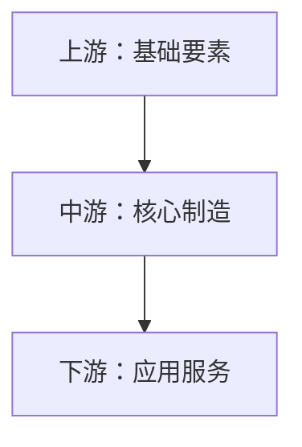

# [产业名称]产业链分析报告（精简版）

**报告生成时间：** [YYYY年MM月]
**分析机构：** 智能产业分析平台

---

## 执行摘要

[待填充：产业核心发现和要点摘要]

---

## 第一章 产业概览

### 1.1 产业定义

[待填充：产业定义、核心特征、发展阶段]

### 1.2 产业重要性

| 价值维度 | 描述 |
|---------|------|
| 经济价值 | [待填充] |
| 战略意义 | [待填充] |
| 技术影响 | [待填充] |

---

## 第二章 产业链结构

### 2.1 产业链架构

### 2.2 上游分析

**关键要素：**
- [待填充]

**主要供应商：**
- [待填充]

**供应风险：**
- [待填充]

### 2.3 中游分析

**核心环节：**
- [待填充]

**主要厂商：**
- [待填充]

**竞争格局：**
- [待填充]

### 2.4 下游分析

**主要应用：**
- [待填充]

**客户类型：**
- [待填充]

**需求趋势：**
- [待填充]

---

## 第三章 市场与技术分析

### 3.1 市场规模

| 年份 | 市场规模（亿元） | 增长率 |
|------|-----------------|--------|
| [待填充] | [待填充] | [待填充] |

**市场预测：**
- [待填充]

### 3.2 核心技术

**关键技术：**
- [待填充]

**技术壁垒：**
- [待填充]

**技术趋势：**
- [待填充]

---

## 第四章 竞争与政策环境

### 4.1 竞争格局

**市场领导者：**
- [待填充]

**主要挑战者：**
- [待填充]

**新兴力量：**
- [待填充]

### 4.2 政策环境

**支持政策：**
- [待填充]

**监管要求：**
- [待填充]

**政策趋势：**
- [待填充]

---

## 第五章 风险机遇与投资分析

### 5.1 主要风险

| 风险类型 | 风险等级 | 应对措施 |
|---------|---------|---------|
| 技术风险 | [待填充] | [待填充] |
| 市场风险 | [待填充] | [待填充] |
| 政策风险 | [待填充] | [待填充] |

### 5.2 发展机遇

**政策机遇：**
- [待填充]

**技术机遇：**
- [待填充]

**市场机遇：**
- [待填充]

### 5.3 投资建议

**投资价值：**
- [待填充]

**推荐领域：**
- [待填充]

**投资时机：**
- [待填充]

**风险提示：**
- [待填充]

---

## 第六章 发展趋势与展望

### 6.1 短期趋势

**市场预期：**
- [待填充]

**技术发展：**
- [待填充]

**政策导向：**
- [待填充]

### 6.2 中长期展望

**产业愿景：**
- [待填充]

**技术革命：**
- [待填充]

**生态演进：**
- [待填充]

---

## 结论与建议

### 核心结论

[待填充：主要结论]

### 行动建议

[待填充：具体行动建议]

---

## 附录

### 数据来源
[待填充]

### 研究方法
[待填充]

### 术语解释
[待填充]

---

**报告结束**
