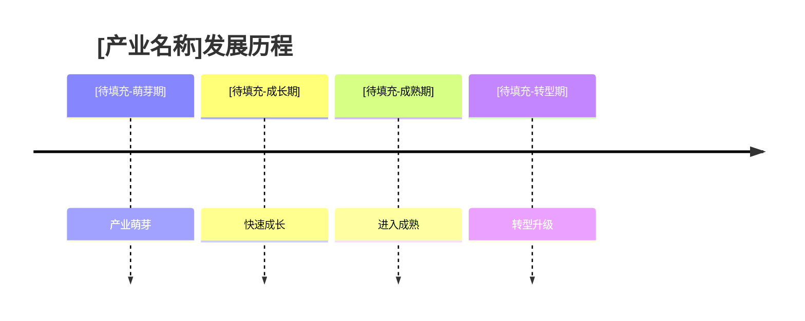
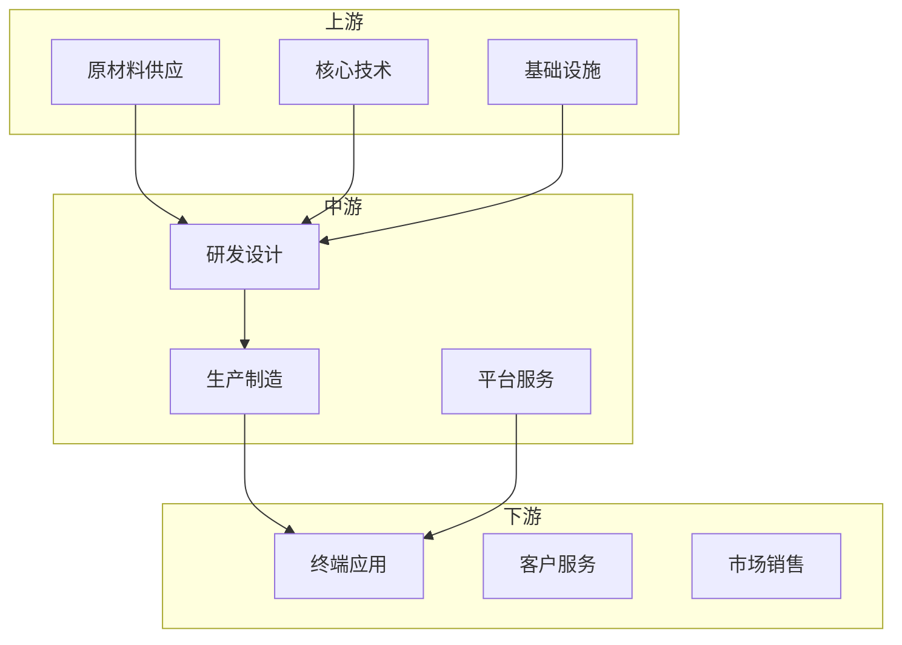
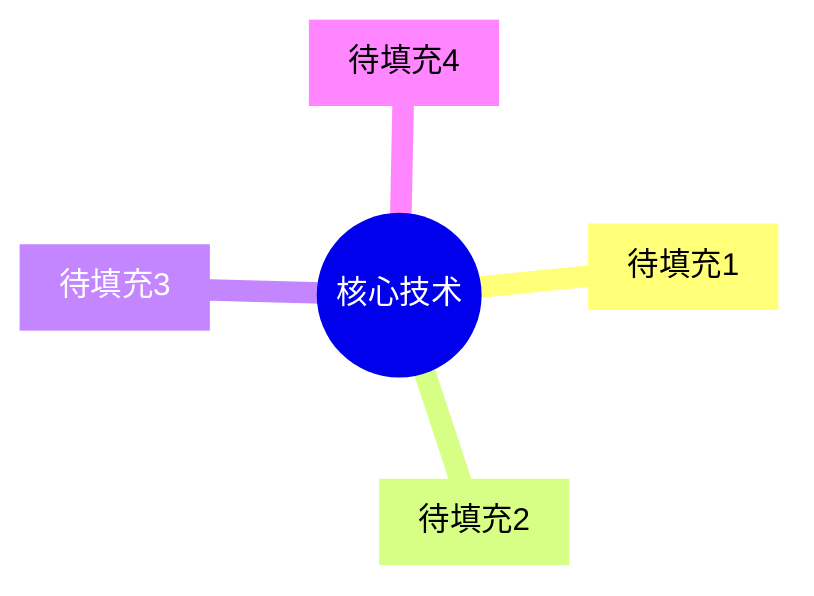
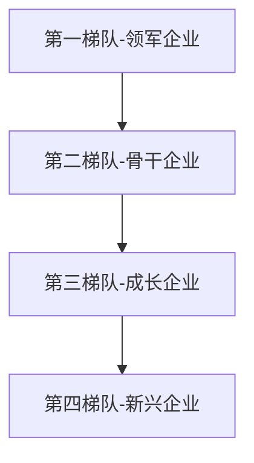
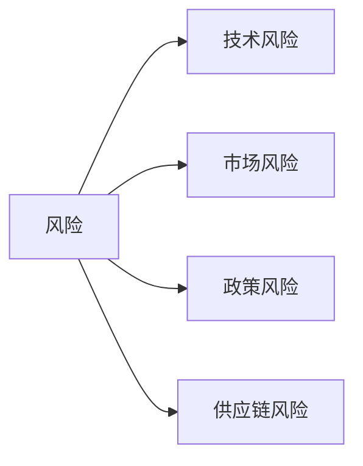

# [产业名称]产业链深度分析报告

**报告生��时间：** [YYYY年MM月]
**分析机构：** 智能产业分析平台

---

## 执行摘要

### 核心发现

[待填充：本报告的核心发现和关键洞察]

### 关键数据指标

| 指标名称 | 数值 | 同比变化 |
|---------|------|---------|
| 市场规模 | [待填充] | [待填充] |
| 增长率 | [待填充] | [待填充] |
| 企业数量 | [待填充] | [待填充] |

### 投资建议概要

[待填充：投资建议摘要]

---

## 第一章 产业概览与定义

### 1.1 产业定义与边界

#### 1.1.1 标准定义

[待填充：产业的官方定义和标准]

#### 1.1.2 产业范围

[待填充：核心产业、关联产业和边缘产业]

#### 1.1.3 产业特征

| 特征维度 | 描述 |
|---------|------|
| 技术密集度 | [待填充] |
| 资本密集度 | [待填充] |
| 人才密集度 | [待填充] |
| 创新活跃度 | [待填充] |

### 1.2 产业发展历程



#### 1.2.1 发展阶段划分

[待填充：各发展阶段的详细描述]

#### 1.2.2 关键里程碑事件

| 时间 | 事件 | 影响 |
|------|------|------|
| [待填充] | [待填充] | [待填充] |

### 1.3 产业重要性评估

#### 1.3.1 经济价值

[待填充：GDP贡献、就业贡献等经济数据]

#### 1.3.2 战略价值

[待填充：国家安全、技术主权等战略意义]

#### 1.3.3 社会价值

[待填充：民生改善、环境影响等社会价值]

---

## 第二章 产业链结构深度分析

### 2.1 产业链整体架构



### 2.2 上游分析：基础要素层

#### 2.2.1 核心要素清单

| 要素类别 | 主要内容 | 依赖度 |
|---------|---------|--------|
| 原材料 | [待填充] | [待填充] |
| 核心技术 | [待填充] | [待填充] |
| 基础设施 | [待填充] | [待填充] |

#### 2.2.2 主要供应商分析

[待填充：上游主要供应商分析]

#### 2.2.3 供应链风险评估

| 风险类别 | 风险等级 | 应对措施 |
|---------|---------|---------|
| 技术依赖 | [待填充] | [待填充] |
| 供应集中 | [待填充] | [待填充] |

### 2.3 中游分析：核心制造层

#### 2.3.1 核心环节分析

[待填充：中游核心环节详细分析]

#### 2.3.2 主要厂商竞争分析

| 企业名称 | 市场份额 | 竞争地位 |
|---------|---------|---------|
| [待填充] | [待填充] | [待填充] |

#### 2.3.3 竞争格局深度分析


### 2.4 下游分析：应用服务层

#### 2.4.1 应用领域全景

[待填充：下游应用领域分析]

#### 2.4.2 客户需求分析

[待填充：客户需求特征和趋势]

#### 2.4.3 渠道模式分析

[待填充：销售渠道和分销体系]

---

## 第三章 市场规模与增长分析

### 3.1 市场规模现状

#### 3.1.1 全球市场规模

| 年份 | 市场规模（亿元） | 增长率 |
|------|-----------------|--------|
| [待填充] | [待填充] | [待填充] |

#### 3.1.2 细分市场结构


### 3.2 市场预测与展望

#### 3.2.1 增长预测模型

[待填充：市场预测方法和模型]

#### 3.2.2 市场规模预测

| 年份 | 预测规模（亿元） | 预测增长率 |
|------|-----------------|-----------|
| [待填充] | [待填充] | [待填充] |

### 3.3 区域市场分析

#### 3.3.1 全球市场格局

[待填充：全球区域市场分析]

#### 3.3.2 中国市场深度分析

[待填充：中国市场区域分布]

### 3.4 价格分析与预测

#### 3.4.1 价格趋势分析

[待填充：价格走势分析]

#### 3.4.2 价格预测

[待填充：未来价格预测]

---

## 第四章 技术发展与创新分析

### 4.1 技术现状评估

#### 4.1.1 核心技术图谱



#### 4.1.2 技术成熟度评估

| 技术领域 | 成熟度 | 国产化率 |
|---------|--------|---------|
| [待填充] | [待填充] | [待填充] |

### 4.2 创新生态分析

#### 4.2.1 研发投入分析

[待填充：行业研发投入情况]

#### 4.2.2 专利分析

| 指标 | 数值 |
|------|------|
| 专利申请总量 | [待填充] |
| 发明专利占比 | [待填充] |
| PCT专利数量 | [待填充] |

### 4.3 技术发展趋势

#### 4.3.1 短期技术趋势

[待填充：1-3年内技术趋势]

#### 4.3.2 中长期技术展望

[待填充：5-10年技术发展方向]

### 4.4 标准体系分析

#### 4.4.1 标准体系现状

[待填充：当前行业标准体系]

#### 4.4.2 标准化发展趋势

[待填充：标准化发展方向]

---

## 第五章 竞争格局与企业分析

### 5.1 整体竞争格局

#### 5.1.1 市场集中度分析

| 指标 | 数值 |
|------|------|
| CR3 | [待填充] |
| CR5 | [待填充] |
| CR10 | [待填充] |

#### 5.1.2 竞争层次分析



### 5.2 重点企业深度分析

#### 5.2.1 第一梯队企业

| 企业名称 | 核心优势 | 市场地位 |
|---------|---------|---------|
| [待填充] | [待填充] | [待填充] |

#### 5.2.2 第二梯队企业

[待填充：第二梯队企业分析]

#### 5.2.3 新兴力量分析

[待填充：新兴创新企业分析]

### 5.3 竞争策略分析

#### 5.3.1 独角兽企业清单

| 企业名称 | 估值 | 核心业务 |
|---------|------|---------|
| [待填充] | [待填充] | [待填充] |

#### 5.3.2 创新企业特征

[待填充：创新企业共同特征]

### 5.4 并购分析

#### 5.4.1 并购趋势

[待填充：行业并购趋势]

#### 5.4.2 重大并购案例

| 时间 | 收购方 | 被收购方 | 交易金额 |
|------|--------|---------|---------|
| [待填充] | [待填充] | [待填充] | [待填充] |

---

## 第六章 政策环境与影响分析

### 6.1 政策环境概述

#### 6.1.1 国家层面政策

| 政策名称 | 发布时间 | 核心内容 |
|---------|---------|---------|
| [待填充] | [待填充] | [待填充] |

#### 6.1.2 地方政策差异

[待填充：地方政策比较]

### 6.2 政策影响评估

#### 6.2.1 正面影响分析

[待填充：政策支持的积极影响]

#### 6.2.2 约束影响分析

[待填充：监管要求带来的挑战]

### 6.3 政策趋势预判

#### 6.3.1 短期政策趋势

[待填充：近期政策方向]

#### 6.3.2 政策建议

[待填充：政策优化建议]

---

## 第七章 风险评估与挑战分析

### 7.1 风险识别与分类

#### 7.1.1 风险分类框架



#### 7.1.2 风险评估矩阵

| 风险类别 | 发生概率 | 影响程度 | 风险等级 |
|---------|---------|---------|---------|
| [待填充] | [待填充] | [待填充] | [待填充] |

### 7.2 重点风险深度分析

#### 7.2.1 技术风险

[待填充：技术路径、知识产权等风险]

#### 7.2.2 市场风险

[待填充：需求波动、竞争加剧等风险]

#### 7.2.3 政策风险

[待填充：监管变化、贸易风险]

### 7.3 风险管控建议

#### 7.3.1 企业层面

[待填充：企业风险应对策略]

#### 7.3.2 行业层面

[待填充：行业风险管控措施]

---

## 第八章 发展机遇与前景展望

### 8.1 发展机遇识别

#### 8.1.1 政策机遇

[待填充：政策红利机遇]

#### 8.1.2 技术机遇

[待填充：技术突破带来的机遇]

#### 8.1.3 市场机遇

[待填充：新兴市场机遇]

### 8.2 发展前景展望

#### 8.2.1 短期发展预判

[待填充：1-3年发展预测]

#### 8.2.2 中长期发展愿景

[待填充：5-10年发展愿景]

### 8.3 发展路径建议

#### 8.3.1 发展路径图

```mermaid
gantt
    title 发展路径
    dateFormat  YYYY
    section 短期
    [待填充1] : [待填充1, 2024]
    section 中期
    [待填充2] : [待填充2, 2027]
    section 长期
    [待填充3] : [待填充3, 2030]
```

#### 8.3.2 关键节点

[待填充：关键发展节点]

---

## 第九章 投资分析与建议

### 9.1 投资价值评估

#### 9.1.1 投资吸引力分析

| 评估维度 | 评分 | 说明 |
|---------|------|------|
| 市场规模 | ★☆☆ | [待填充] |
| 增长潜力 | ★☆☆ | [待填充] |
| 技术壁垒 | ★☆☆ | [待填充] |

#### 9.1.2 投资回报预期

[待填充：投资回报分析]

### 9.2 投资机会识别

#### 9.2.1 重点投资领域

[待填充：推荐投资领域]

#### 9.2.2 投资时机分析

[待填充：最佳投资时机]

### 9.3 投资建议与策略

#### 9.3.1 投资策略建议

[待填充：具体投资策略]

#### 9.3.2 风险控制建议

[待填充：投资风险控制]

---

## 结论与建议

### 核心结论

[待填充：报告核心结论]

### 行动建议

[待填充：具体行动建议]

---

## 附录

### 数据来源

[待填充：数据来源说明]

### 研究方法

[待填充：研究方法说明]

### 术语解释

| 术语 | 解释 |
|------|------|
| [待填充] | [待填充] |

### 参考资料

[待填充：参考资料列表]

---

**报告结束**
